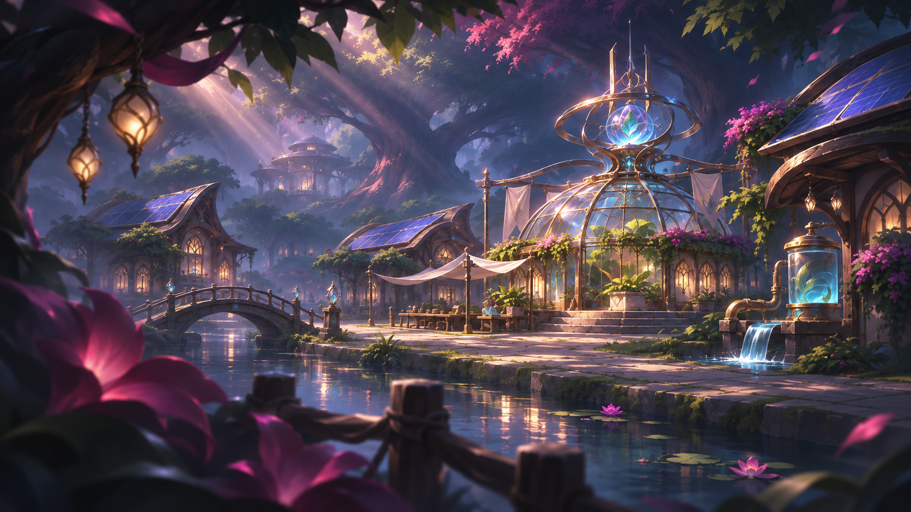
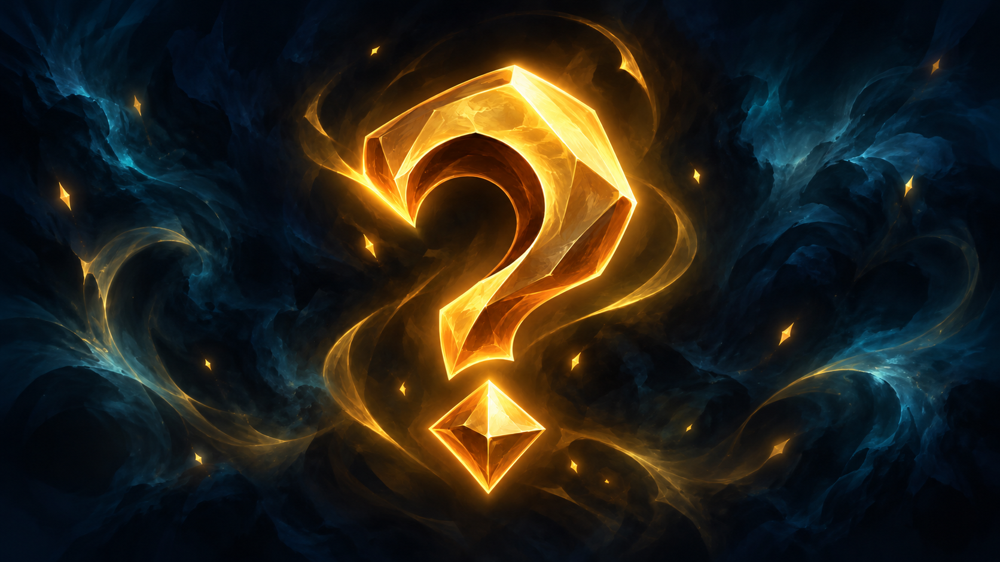

Elves are the heirs of the Galwarians, bearers of an endless grace and of an ancient bond with nature. In the world of Eden they dwell in the hollows of the world-trees that Élyséa brought forth, their homes rising in slender walkways and platforms of living wood, lit by the phosphorescent glow of druidic runes. They move lightly beneath the canopy, where the song of the leaves and the murmur of the rivers weave a constant melody. Driven by a deep respect for life, they seek balance and beauty in the magic of nature, cultivating craft and poetry rather than exploitation and profit.

> "Élyséa… why do you let this happen? Here? If you were truly there, we would not be in this chaos: this war should never have broken out. How many more lives must be sacrificed for a cause that has lost all meaning? What do we do when everything seems to be burning away? Wait? Watch? And all the while, my people die. Where are you when I need you? I will protect Brécelann, with or without you."
>
> :source[**Queen Tiar Vyrefiel**, addressing the goddess **Élyséa** in the sanctuary of Teyrdrassil, the World-Tree, a few years after the Second Radiance, at the dawn of the war of Brécelann.]{bottom-right echo}

## A sylvan heritage

:caption["The Last Galwarians", illumination]

Elves descend from the ancient Galwarians, those masters of primordial magic who once shaped Eden alongside the ancient dragons. When the First Radiance ravaged their powers, a band of exiles withdrew into the deep forests and called upon the goddess Élyséa, guardian of the wild.

Moved by their torment, she breathed part of her strength into the very roots of Eden, giving birth to the world-trees and teaching the last Galwarians to draw on sap and chlorophyll rather than on the ancient fire. Ever since, elven magic has flowed through the sap of thousand-year-old beeches and danced in the mist of the glades, binding the elves forever to the breath of nature and to the sacred balance of their world.

Drow, Fir Bolg and halflings also descend from the last Galwarians, and they share Élyséa's gift with the elves. Orcs, trolls and goblins carry Galwarian blood too, like every people with pointed ears, but their lines had mixed with demonic or fey blood, so Élyséa withheld her gift from them.

## Civilisation and cities

:caption[The Roscarra canal running through Glenmor]

At the foot of every world-tree rises a great elven city, a living foundation embodying the alliance of nature and civilisation, where towers of green glass glitter in the sun and gilding traces patterns of foliage. Gardens climb the towers in terraces, from orchards to beds of healing herbs. Higher up, the homes lie within the trunk of the world-tree itself, linked to the towers by slender walkways of living wood that run from platform to platform, right up beneath the canopy. Each home takes years to make, because the tree must grow into the shape it is given.

Craftspeople work behind the glass, at workbenches lit by green-tinted sunlight. At dusk, the druidic runes traced along the walkways light up one by one, their glow drawn from the sap of the world-tree.

Away from the great cities, other elves live in villages nestled in the hollows of trees or along riverbanks, where their dwellings melt into the greenery: structures of semi-opaque green glass adorned with organic gilding, or "living" houses shaped around and within the trunks, respecting the natural growth of the trees.

The elves' economy rests above all on barter: craftspeople of high standing, they trade fine cloth, wooden jewellery and enchanted gems for bare necessities (rare goods, and the metals they refuse to mine themselves), shunning any overconsumption or abusive exploitation. Guided by the teaching of Élyséa, they take from the forest only what is vital, gathering with restraint and using ancestral techniques to restore and cultivate without ever harming the land. Every collective decision is reached by consensus during the vigils of the Canopy, where elders and young alike keep watch over the fragile balance of their world.

## Elven society

In elven society, power and authority belong above all to women, embodied by a queen regent: it is a matriarchy in which lineages pass through the mother, who herself chooses the heiress of her name and her duties. The great cities at the foot of the world-trees are governed by councils of matrons, made up of the eldest women of each clan, whose wisdom guides political, cultural and spiritual decisions. The priestesses of the sylva, charged with keeping the balance between druidic magic and wildlife, hold a central place and serve as intermediaries between Élyséa and the people.

Young elves, whatever their gender, learn from childhood to respect maternal authority and to honour their elders, but it is the women who hold the keys to the archives, the healing lore and the sacred rites. This order guarantees a stability of millennia: power, embodied by the protecting mother, sees to it that every generation carries on the harmony with nature and the ancestral memory.

## Culture and nobility

Cultural life in the royal cities at the foot of the world-trees blossoms around the arts: druidic music with bewitching melodies, poetry sung during the vigils beneath the boughs, the carving of wood and living stone, and the weaving of cloth steeped in lunar magic.

Though every elf deeply respects Élyséa and honours the world-trees as the first source of their magic, not all worship her formally; some seek other spiritual paths, while keeping a sincere respect for the goddess who saved their ancestors.

Alongside this, the elven art of combat is known for its nobility and grace: warriors and wardens train from childhood with the fine sword and the longbow in ritual passes through the glades, learning a fluid strategy that mimics the movement of branches in the wind. The martial academies, open to nobles and adventurers alike, pair physical discipline with druidic meditation, so that every gesture and every shot is in harmony with the spirit of the world. Thus, between the song of bards and the dance of blades, elven culture keeps alive an ideal of balance in which beauty and efficiency are one.

## A haughty people

For centuries the elves remained a discreet people, withdrawn into the heart of their cities at the foot of the world-trees and trading only with the halflings of the plains, famed for their simple wares and their knack for barter. This exclusive relationship, built on mutual trust and respect for custom, let the elves preserve their culture and their harmony with nature while exchanging fine cloth and druidic essences for food and crafted goods.

But after the Second Radiance, the mass arrival of the humans upset that balance: they crossed the elven borders and started more than half a century of conflicts that ravaged forests and cities. From that long war grew a stubborn mistrust: wounded in their sacred sanctuary, the elves learned to shield themselves behind a veil of arrogance and to judge strangers with caution, a caution often taken for haughtiness by those who did not have the preservation of the natural world at heart.

## An elegant build

Elves stand out for their slender silhouette and their proud bearing. Their height usually ranges between 1.50 m and 1.80 m, for a weight between 45 kg and 65 kg, men and women sharing very similar builds. Their features have an almost sculptural finesse: high cheekbones, a delicate jaw and a smooth brow. Their ears end in a fine point, recalling the shape of a leaf, and their skin, smooth and beardless, gives their faces an unchanging look.

Their complexions range from the usual human tones (ivory, tanned, light brown) to more exotic shades: polished copper, satin bronze or bluish white. Their hair, often long and silken, takes on the colours of nature: browns and blonds sometimes mingle with leafy tones (deep greens, misty blues, even silver). As for their gaze, it seems to catch the light: golden irises, liquid silver or emerald green, lending an almost supernatural gleam that betrays their communion with the magic of sap and leaf.

Their everyday dress weds elegance and practicality: tunics and braids adorned with plant motifs, fine cloth dyed moss green, ochre and sky blue, finished with light golden embroidery recalling the veins of leaves. Their jewellery, often made of carved wood, natural gems or bronze filigree, is discreet but refined, highlighting forms without ever hindering the fluid, airy movements that mark every elven step.

## Elven names

Among the elves of Eden, every first name carries a true legacy: it is born of a glorious event in the family or a notable moment in the village's history, whether a victory over an ancient scourge or the discovery of a forgotten glade. Elves do not divide first names into "masculine" and "feminine" as humans do; the same name can suit one as well as the other, reflecting their view of identity beyond differences of gender.

Family names, passed down through the mother, are drawn from a guardian creature that watches over the lineage or from the world-tree beneath which the clan has made its home, a sign of their unbreakable bond with nature and the protection it offers them. An elven name is thus always a living story, a murmur of memory and promise passed on with every birth.

Mixed names
: Adhran, Aeryn, Bryndar, Caelith, Daeris, Eryndor, Faelith, Gaelwyn, Helindor, Illarien, Jaedryn, Kaelith, Luthien, Maerion, Naeris, Olyndor, Phaeron, Quelindra, Rhaella, Saelar, Thalion, Ulvaris, Vaelora, Wyneth, Xandriel, Ysilith, Zephyra, Aerion, Branthir, Cerelyth, Dornath, Elorim, Farendir, Galathor, Ivariel, Jorendil, Kiralyn, Leyanth, Moriel, Nythorin.

Family names
: Gerawen, Faelgorn, Aelor, Thandril, Myrath, Halindor, Oryndel, Elandor, Coranthia, Brethil, Fenrath, Galdorin, Drakanor, Sylvinar, Yavandil, Rhyolin, Vorandel, Quenelor, Nelgros, Vyranth, Thalorin, Althoris, Ilveran, Sorandir, Caranthor, Elashar, Danthir, Lyrandor, Mirelith, Faerendil, Nymren, Pelorin, Quelinar, Ryndor, Sylendril, Tharion, Valtorin, Ylandeor, Caerindel, Dorandel, Evelith, Mirithor.
