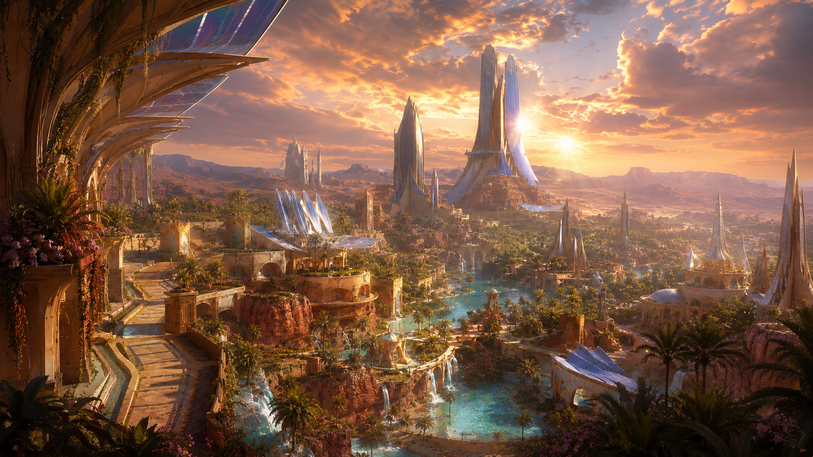

Les elfes sont les héritiers des Galwariens, porteurs d'une grâce infinie et d'un lien millénaire avec la nature, où ils puisent la magie que leur donna la déesse Élyséa. Dans le monde d'Eden, ils habitent au creux des arbres-mondes qu'Élyséa a fait apparaître, leurs demeures s'élevant en fines passerelles et plateformes de bois vivant, éclairées par la lueur phosphorescente des runes. Ils se meuvent avec légèreté sous la canopée, où le chant des feuilles et le murmure des rivières tissent une mélodie constante. Animés par un profond respect pour la vie, ils vont chercher dans la magie de la nature l'équilibre et la beauté, cultivant l'artisanat et la poésie plutôt que l'exploitation et le profit.

> « Élyséa… pourquoi laisses-tu cela arriver ? Toute ma vie, je t'ai servie, comme les mères de mes mères avant moi. Est-ce là ce que tu nous rends ? Toutes les vies se valent, n'est-ce pas ? Il faudrait laisser la vie suivre son cours… Attendre ? Observer ? Et pendant ce temps, mes gens meurent. Les miens me regardent avec dégoût : à leurs yeux, je suis une reine qui a failli. Je ne sais même plus si tu m'entends. Où es-tu quand j'ai besoin de toi ? Voici mon dernier avertissement… Je protégerai Brécelann, avec… ou sans toi. »
>
> :source[**La reine Tiar Vyrefiel** s'adressant à la déesse **Élyséa** dans le sanctuaire de l'arbre-monde Tiardrassil, à l'aube de la bataille de Brécelann.]{bottom-right echo}

## :icon[game-icons:elf-ear] Les derniers Galwariens

:caption[« Les derniers Galwariens », enluminure]

Les elfes descendent des anciens Galwariens, ces maîtres de la magie primordiale qui, jadis, façonnaient Eden aux côtés des dragons anciens. Lorsque le Premier Éclat ravagea leurs pouvoirs, un groupe d'exilés se retira dans les forêts profondes, appelant à l'aide la déesse Élyséa, gardienne de la vie sauvage.

Touchée par leur supplice, elle insuffla une part de sa force aux racines mêmes d'Eden, faisant naître les arbres-mondes et enseignant aux derniers Galwariens l'art de puiser dans la sève, le vent, la chlorophylle et dans toute la nature environnante. Depuis lors, la magie de la nature coule dans les clans issus des derniers Galwariens, dont ceux des elfes, les liant à jamais à la respiration de la nature et à l'équilibre sacré de leur monde.

Élyséa enseigne qu'il faut laisser la vie suivre son cours, car toutes les vies se valent. Si chaque elfe respecte profondément Élyséa et honore les arbres-mondes comme source première de sa magie, tous ne lui vouent pas un culte formel ; certains cherchent néanmoins d'autres voies spirituelles, tout en gardant un respect sincère pour la déesse qui sauva leurs ancêtres.

De tous les descendants des Galwariens, les elfes furent les premiers que rencontrèrent les humains ; ce sont donc eux qu'on associe le plus à ces ancêtres. On dit qu'ils sont les plus semblables aux Galwariens et que toutes les autres lignées se sont bien trop éloignées de leur souche. Les elfes sont réputés pour rappeler à tout sot qui l'ignorerait encore qu'il y a quelques millénaires à peine, leurs ancêtres régnaient sur cette terre et sur sa magie.

Les elfes appartiennent à une lignée ancienne, forgée dans les racines profondes d'Eden et les murmures éternels des bois premiers. Les elfes sont les gardiens d'un équilibre oublié, héritiers d'antiques pactes entre la magie, la nature et les étoiles.

## :icon[game-icons:burning-forest] Un demi-siècle de guerre

Pendant des siècles, les elfes sont restés un peuple discret, repliés au cœur de leurs cités au pied des arbres-mondes et n'entretenant de liens commerciaux qu'avec les halfelins des plaines, célèbres pour leurs marchandises simples et leur sens du troc. Cette relation exclusive, fondée sur la confiance mutuelle et le respect des coutumes, permit aux elfes de préserver leur culture et leur harmonie avec la nature, tout en échangeant étoffes fines et essences contre denrées et objets artisanaux.

Mais, après le Second Éclat, l'arrivée massive des humains bouscula cet équilibre : ils franchirent les frontières elfiques et déclenchèrent plus d'un demi-siècle de conflits qui ravagèrent forêts et cités.

Cette guerre, celle de Brécelann, s'acheva par une dernière bataille du même nom, qui fut livrée près de Glenmor, un petit village à l'orée de la forêt, et tourna au massacre dans les deux camps. Jacques « Le Scellaire » Arsenault appela alors à la paix et se fit le médiateur entre Arthur Colbert et la reine Tiar Vyrefiel. Le traité de Glenmor mit fin à la guerre.

De cette longue guerre naquit une méfiance tenace : les elfes, blessés dans leur sanctuaire sacré, apprirent à se protéger derrière un voile d'arrogance et à juger les étrangers avec prudence, souvent perçue comme hautaine par ceux qui n'avaient pas à cœur la préservation du monde naturel.

## :icon[game-icons:crenel-crown] La Matriarchie

:caption[La Matronobriga de la cité de Brivomagos]

Dans la société elfique, le pouvoir et l'autorité sont avant tout l'apanage des femmes, incarnés par une reine régente : c'est la Matriarchie, où les lignées se transmettent par la mère, qui choisit elle-même l'héritière de son nom et de ses responsabilités.

Il arrive que des villages et des cités s'unissent sous une Reinauté et forment un Reinaume, comme le Reinaume de Brécelann. Une reine régente y gouverne : c'est elle qui décide, aidée d'un conseil de quatre matrones qui représentent chacune de grandes cités ou des clans, et dont la sagesse guide les décisions politiques, culturelles et spirituelles. Chaque Reinaume a son siège du pouvoir, la Matronobriga, où se débat et se décide la vie politique du Reinaume.

Dans les villages et les groupes plus petits et autonomes, toute décision collective est prise par consensus lors des veillées de la Canopée, où anciens et jeunes veillent ensemble à préserver l'équilibre fragile de leur monde.

Les prêtresses de la sylve, chargées de veiller à l'équilibre entre la magie et la vie sauvage, occupent une place centrale et servent d'intermédiaires entre Élyséa et le peuple. Les jeunes elfes, quel que soit leur genre, apprennent dès l'enfance à respecter l'autorité maternelle et à honorer les anciens, mais ce sont les femmes qui détiennent les clés des archives, les savoirs médicinaux et les rituels sacrés. Cette structure garantit une stabilité millénaire : le pouvoir, incarné par la mère protectrice, veille à ce que chaque génération perpétue l'harmonie avec la nature et la mémoire ancestrale.

## :icon[game-icons:dagger-rose] Passes d'armes dans les clairières

L'art du combat elfique se distingue par sa noblesse et sa grâce : les guerriers et gardiens s'entraînent dès l'enfance à manier l'épée fine et l'arc long lors de passes rituelles dans les clairières, apprenant la stratégie fluide qui imite le mouvement des branches au vent. Les académies martiales, ouvertes à la fois aux nobles et aux aventuriers, allient discipline physique et méditation, veillant à ce que chaque geste, chaque tir, soit en harmonie avec l'esprit du monde.

## :icon[game-icons:tree-door] Cités de verre et de bois vivant

:caption[Le canal de Roscarra traversant Glenmor]

Au pied de chaque arbre-monde s'érige une grande cité elfique, fondation vivante incarnant l'alliance entre nature et civilisation, où les tours de verre vert scintillent au soleil et les dorures dessinent des motifs de feuillages. Dans ces cités royales, la vie culturelle s'épanouit autour des arts : la musique aux mélodies envoûtantes, la poésie chantée lors des veillées sous les frondaisons, la sculpture du bois et de la pierre vivante, ainsi que le tissage de tissus infusés de magie. La langue elfique est un chant lent, tissé de poésie et d'harmoniques, que peu d'êtres mortels peuvent reproduire avec justesse.

Hors des grandes cités, d'autres elfes vivent en villages nichés au creux des arbres ou le long des rives, où leurs habitations se fondent dans la végétation : des structures en verre vert semi-opaque, ornées de dorures organiques, ou des maisons « vivantes » façonnées dans les troncs et autour d'eux, respectant la croissance naturelle des arbres.

L'économie des elfes repose avant tout sur le troc : artisans de haut rang, ils échangent étoffes fines, bijoux en bois et gemmes enchantées contre le strict nécessaire (métaux qu'ils refusent de miner eux-mêmes, denrées rares), évitant toute surconsommation ou exploitation abusive. Guidés par l'enseignement d'Élyséa, ils ne prélèvent de la forêt que ce qui est vital, pratiquant une cueillette raisonnée et utilisant des techniques ancestrales pour restaurer et cultiver sans jamais dégrader les lieux.

## :icon[game-icons:gem-chain] Le port et la parure

Les elfes se distinguent par leur silhouette élancée et leur port altier. Leur taille oscille généralement entre 1,50 m et 1,80 m, pour un poids situé entre 45 kg et 65 kg, hommes et femmes affichant des gabarits très proches. Leurs traits sont d'une finesse presque sculpturale : pommettes hautes, mâchoire délicate et front lisse. Les oreilles se terminent en pointe fine, rappelant la forme d'une feuille, et leurs chairs, lisses et imberbes, confèrent à leur visage un aspect immuable.

La palette de leurs carnations va des teintes humaines classiques (ivoire, hâlé, brun clair) aux nuances plus exotiques : cuivre poli, bronze satiné ou blanc bleuté. Leurs cheveux, souvent longs et soyeux, adoptent les couleurs de la nature : bruns et blonds se mêlent parfois à des tons feuillus (verts profonds, bleus brumeux, voire argentés). Quant au regard, il paraît capturer la lumière : iris dorés, argent liquide ou vert émeraude, offrant un éclat presque surnaturel qui trahit leur communion avec la magie de la sève et des feuilles.

Leur tenue quotidienne marie élégance et fonctionnalité : tuniques et tresses ornées de motifs végétaux, tissus fins teintés de vert mousse, d'ocre et de bleu ciel, complétés de légères broderies dorées évoquant les nervures foliaires. Les bijoux, souvent confectionnés en bois gravé, gemmes naturelles ou filigranes de bronze, sont discrets mais raffinés, soulignant les formes sans jamais entraver les mouvements fluides et aériens qui caractérisent chaque pas elfique.
