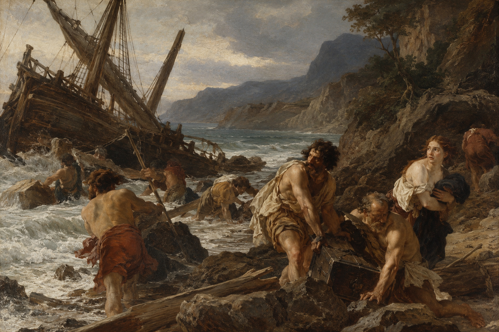
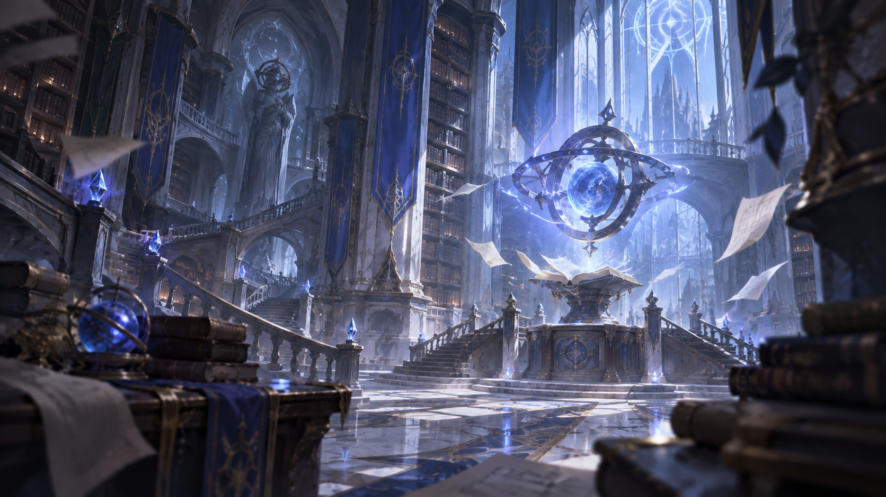

Humans are artisans of hope and action, a people of boundless creativity and an unquenchable thirst for adventure. They raise cities of stone and metal, work steel and tame a nascent magic. Forever on the move, they cross plains, forests and mountains, guided by curiosity and the wish to understand. Humans cherish art and music, celebrate poetry as much as ingenuity, and know how to savour simple pleasures as well as great conquests. Their heart swings endlessly between a passion for renewal and respect for tradition.

> "Arthur, look at these steles: so many men and elves have shed their blood here. How many more lives must be sacrificed before we understand that victory by the sword does not forge peace? If humanity wants to endure in these lands, it must raise the word before arms, use its ingenuity to build bridges rather than ramparts, and set diplomacy at the heart of its designs. The Bastion must embody that design: a home of reconciliation where this senseless slaughter finally ends."
>
> :source[**Jacques "Le Scellaire" Arsenault**, addressing **Arthur Colbert** at the dawn of the great battle of Brécelann.]{top-left tranche}

## :icon[game-icons:ship-wreck] The Coming

:caption["The Castaways of the Coming", painted in 238 AC.]

Humans came to Eden from the lost continent of Pandore aboard several ships, and that arrival, a mystery to this day, is called the Coming. Every one of them reached Eden unconscious. Strangely, when they woke, each still remembered their friends, their family, old quarrels and even the skills of their trade, yet nothing of their land: not the colour of the grass, not their own house. All they had managed to keep of their former home was a name, Pandore. Having come on separate ships, they founded several small tribes and kingdoms once ashore.

Other peoples had lived on that land for centuries. Some of the newcomers sought their salvation in the eloquence of pacts and the sharing of knowledge, while others sought it in the clash of arms or in otherworldly powers. Those who chose pacts learned the art of negotiation and alliance there, and it still makes humans the natural mediators of Eden. Knights of Nouvelle-Aubaine, engineers of Landenheit and scholars of Victoria all know how to weave a web of trust with the other peoples, and trade has become their universal language: cargoes of silk, spice and steam-driven machinery travel under the auspices of skilled emissaries.

Years are counted "Before the Coming" and "After the Coming" (BC and AC), yet year 0 is the last day of the battle of Brécelann, the day of the peace treaty between elves and humans. Humans and elves spread this reckoning across Eden, as they spread the Common, in memory of those who died at Brécelann. Some speak instead of the Common Era, or of the Second Radiance, after the curse that struck every living creature on Eden shortly before the humans arrived, at a date close to year 0. The reference day is the same whichever name is used.

## :icon[game-icons:battleship] The Eisenriese

Of the ships that carried humans to Eden at the Coming, the Eisenriese, known as "the Giant of Iron", is one of the few still intact. It belongs to Ulriech Strasswalker. It is said that although Ulriech was as unconscious as everyone else, his engineering was so refined that the Eisenriese changed course by itself and came ashore on what is now Landenheit so precisely that it took no damage at all.

Ulriech is one of the Blessed: a human who, for reasons no one knows, is immortal and cannot be killed by anything. He is the Kaiser of Landenheit, and the Eisenriese is both the capital of Landenheit and the seat of command for the whole Empire.

Fortunately for a people who had forgotten everything about their land, the Eisenriese held a whole floor set aside for human works from Pandore, and that collection is still the richest in ancient writings. Some, written in what is now called Old Common, cannot be read. Others, more modern, could be studied, and from them humans learned the little they know about their old life in Pandore and who had ruled it: the Emperor Izarus Toltec.

Many are scientific compendiums. With them, humans rebuilt most of their old technology, none of which drew its power from magic or from Catalysts.

## :icon[game-icons:mounted-knight] Nouvelle-Aubaine and the Weitzguard

When the great battle of Brécelann dawned, Arthur Colbert was not yet a king, for there was no Nouvelle-Aubaine. The Bastion was then little more than a fortified camp holding out against the elves. Once the war was over, the camp became the town it is today, and Arthur took up his seat there. He then went from tribe to tribe and from kingdom to kingdom to unite what would become Nouvelle-Aubaine, and reigned as its first king.

Little by little, emissaries from Victoria and Landenheit became a familiar sight in Nouvelle-Aubaine. Hoping to build a safer Eden for all, the three decided to create the Weitzguard, a military and economic alliance.

The Weitzguard's armed hand, the **Parangons**, takes recruits from every people. The elite corps is split first into three branches, one for each member of the alliance. Nouvelle-Aubaine's branch answers to the Illustrious General, Landenheit's to the Illustrious Admiral and Victoria's to the Illustrious Archmagus. Each branch is split again into many orders, among them the Order of Sibyls, the Order of Nemerites, the Order of Etherblades and the Order of Pethricites.

Parangons combine the duties of a city militia, the rigour of a special police force and the courage of hunters of supernatural creatures. They roam the wilds and the fortified cities to come to the aid of the people, hunting down monsters and conspiracies with steel and the magical arts. Every great city keeps its garrison of Parangons, while the most seasoned wander from land to land.

## :icon[game-icons:magic-swirl] The Oracles

:caption[The library of the Oracles' Academy]

The Oracles are the six most powerful known practitioners of primordial magic, and each of them is the strongest in their element. So far, only humans have been chosen to hold that rank. Sitting together as the **Assemblée des Oracles**, they regulate the teaching and use of magic in every academy.

The first Oracles were elected by the council of the three regents, the rulers of the alliance's three members. The Oracles now choose their own: when one of them dies, the others gather and name the most powerful practitioner of that element to succeed them. The Weitzguard must approve the choice. Since the Oracles recently took on a political and military role, the three commanders of the Parangons, the Illustrious General, Admiral and Archmagus, must give their approval as well.

Most Oracles were found at the Oracles' Academy, and so was Augure, who now holds the rank of Oracle of Lightning. She is barely fifteen and already outmatches every known lightning mage. It is said that she can travel from the Bastion to Eisenriese, the capital of Landenheit, in a single second.

## :icon[game-icons:qaitbay-citadel] The city guilds

In the human cities, the authorities adopted the guild model to give every field a structure: trade, craft, learning or magic. After the humans arrived, many guilds of scholars formed, some to understand their new home better, others to try to recover what they could about the lands they had come from. The guild of the **Sagemeisters** was founded by humans, yet most of its scholars come from other peoples. It coordinates scientific expeditions and records the customs of Eden.

Other brotherhoods came into being: guilds of smiths and engineers, circles of healers devoted to remedies and herb-lore, companies of diplomats, and leagues of cartographers who map roads and lines of communication. Each was born in a human town and brings together people of one trade, who pass on their knowledge there and stand by one another through Eden's hardships.

## :icon[game-icons:bookmark] Nomad scholars

Humans carry within them a drive to discover and a morality shaped by uprooting. They see every native people as the keeper of precious knowledge, and try to understand it rather than dominate it. Frictions arise, notably with the elves, but most humans show sincere goodwill: they respect local customs and take care not to wear away the balances already in place.

Their ingenuity turns as readily to the exploration of magical arcana as to the study of Galwarian traditions and draconic rites. They live by a moral code that prizes exchange, hospitality and shared progress, and they treat every encounter as a chance to enrich one another.
