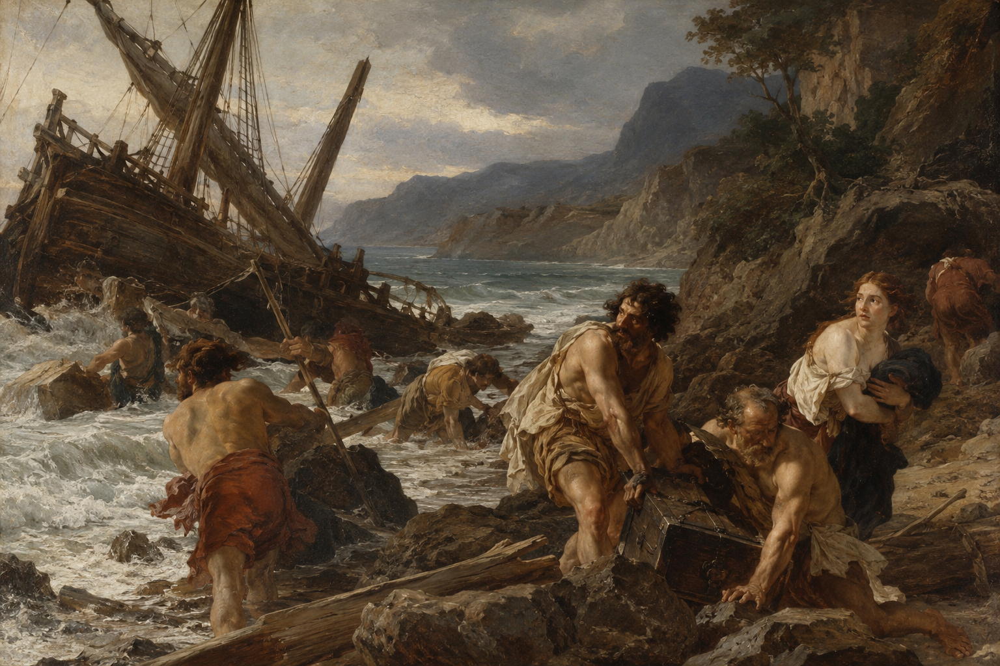
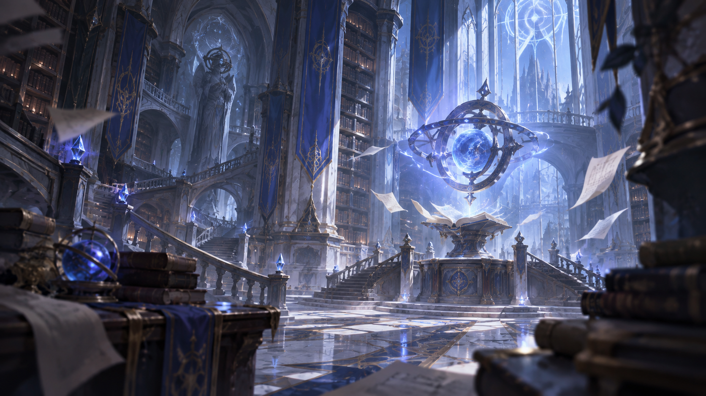

Les humains sont des artisans de l'espoir et de l'action, peuple d'une créativité sans bornes et d'une soif d'aventure inextinguible. Ils élèvent des cités de pierre et de métal, taillent l'acier et apprivoisent la magie naissante. Toujours en mouvement, ils traversent plaines, forêts et montagnes, guidés par la curiosité et le désir de comprendre. Les humains chérissent l'art et la musique, célèbrent la poésie autant que l'ingéniosité, et savent savourer les plaisirs simples comme les grandes conquêtes. Leur cœur oscille sans cesse entre la passion du renouveau et le respect des traditions.

> « Arthur, vois ces stèles : tant d'hommes et d'elfes ont versé leur sang ici. Combien de vies faudra-t-il encore sacrifier avant que nous comprenions que la victoire à l'épée ne forge pas la paix ? Si l'humanité veut durer sur ces terres, elle doit brandir la parole avant les armes, utiliser son ingéniosité pour bâtir des ponts plutôt que des remparts, et placer la diplomatie au cœur de ses desseins. Le Bastion doit incarner ce dessein : un foyer de réconciliation où cesse enfin ce massacre insensé. »
>
> :source[Jacques « Le Scellaire » Arsenault s'adressant à Arthur Colbert à l'aube de la grande bataille de Brécelann.]

## La Venue

:caption[« Les Naufragés de la Venue », toile peinte en 238 apr. V.]

Les humains vinrent sur Eden depuis le continent perdu de Pandore, à bord de plusieurs navires, et c'est cette arrivée, restée un mystère, qu'on appelle la Venue. Tous touchèrent Eden sans connaissance. Étonnamment, à leur réveil, chacun se rappelait ses amis, sa famille, les querelles d'antan et jusqu'aux savoirs de son métier, mais plus rien de sa terre : pas même la couleur de l'herbe, pas même sa maison. La seule chose qu'ils avaient su garder de leur ancien foyer était ce nom, Pandore. Répartis entre ces navires, ils fondèrent, une fois sur Eden, plusieurs petites tribus et petits royaumes.

Arrivés sur une terre que d'autres peuples habitaient depuis des siècles, certains humains cherchèrent leur salut dans l'éloquence des pactes et le partage du savoir, tandis que d'autres le cherchèrent dans le fracas des armes ou auprès de puissances d'un autre monde. Les premiers y apprirent l'art de la négociation et de l'alliance, qui fait encore des humains les médiateurs naturels d'Eden. Chevaliers de la Nouvelle-Aubaine, ingénieurs du Landenheit ou érudits de la Victoria, ils savent tisser des réseaux de confiance avec les autres peuples, et le commerce est devenu leur langue universelle : des cargaisons de soieries, d'épices et de mécanismes à vapeur circulent sous les auspices d'émissaires habiles.

On compte les années « avant la Venue » et « après la Venue » (av. V. et apr. V.), mais l'an 0 de ce calendrier est le dernier jour de la bataille de Brécelann, celui du traité de paix entre elfes et humains. Humains et elfes répandirent cette convention à travers Eden, comme le Commun, en mémoire des victimes de Brécelann. Certains parlent plutôt d'« ère commune » (av. è. c. et apr. è. c.) ou de « Second Éclat » (av. s. é. et apr. s. é.), du nom de la malédiction qui frappa toutes les créatures vivantes d'Eden peu avant l'arrivée des humains, à une date proche de l'an 0. Le jour de référence reste pourtant le même.

## L'Eisenriese

Parmi les navires qui amenèrent les humains sur Eden lors de la Venue, l'Eisenriese, dit « Le Géant de Fer », est l'un des rares encore intacts. C'est le navire d'Ulriech Strasswalker. On dit que, bien qu'Ulriech fût inconscient comme tous les autres, son ingénierie était si aboutie que l'Eisenriese changea de cap de lui-même et accosta sur le rivage de ce qui est aujourd'hui le Landenheit, si parfaitement qu'il n'en subit aucun dommage.

Ulriech est un Béni : un humain qui, pour une raison inconnue, est immortel, et que rien ne peut tuer. Il est le Kaiser du Landenheit, et l'Eisenriese est à la fois la capitale du Landenheit et le siège du commandement de tout l'Empire.

Pour une humanité qui avait tout oublié de sa terre, ce fut une chance : l'Eisenriese comportait un étage entier réservé aux ouvrages humains venus de Pandore, et cette collection reste, à ce jour, la plus fournie en ouvrages anciens. Certains sont illisibles, écrits dans ce qu'on appelle désormais l'Ancien Commun. D'autres, plus modernes, ont pu être étudiés : ils ont appris aux humains le peu de choses qu'ils savent sur leur ancienne vie à Pandore, et leur ont fait connaître son ancien souverain, l'empereur Izarus Toltec.

Beaucoup sont des recueils scientifiques. Les humains s'en servirent pour recréer l'essentiel de leur ancienne technologie, qui ne tirait son énergie ni de la magie ni des Catalyseurs.

## La Nouvelle-Aubaine et la Weitzguard

À l'aube de la grande bataille de Brécelann, Arthur Colbert n'était pas encore roi : la Nouvelle-Aubaine n'existait pas. Le Bastion n'était alors guère qu'un camp fortifié pour résister aux elfes. Quand la guerre prit fin, le camp devint la ville que l'on connaît, et Arthur y établit son siège. De là, il alla de tribu en tribu et de royaume en royaume pour unifier ce qui allait devenir la Nouvelle-Aubaine, dont il fut le premier roi.

Peu à peu, des émissaires de la Victoria et du Landenheit se firent fréquents en Nouvelle-Aubaine. Dans l'espoir de faire d'Eden une terre plus sûre pour tous, la Nouvelle-Aubaine, la Victoria et le Landenheit décidèrent de créer la Weitzguard, une alliance militaire et économique.

Les **Parangons**, main armée de la Weitzguard, ouvrent leurs rangs à tous les peuples. Ce corps d'élite se divise d'abord en trois branches, une pour chacun des membres de l'alliance. Le Général Illustre commande celle de la Nouvelle-Aubaine, l'Amiral Illustre celle du Landenheit et l'Archmagus Illustre celle de la Victoria. Chaque branche se divise à son tour en de multiples ordres, parmi lesquels l'Ordre des Sibylles, l'Ordre des Némérites, l'Ordre des Lame-éther et l'Ordre des Péthricites.

Les Parangons mêlent les missions d'une milice citadine, la rigueur d'une police d'exception et la bravoure de chasseurs de créatures surnaturelles. Ils arpentent terres sauvages et cités fortifiées pour venir en aide aux populations, traquant monstres et conspirations par l'acier et l'art magique. Chaque grande cité dispose de sa garnison de Parangons, tandis que les plus aguerris vagabondent d'un pays à l'autre.

## Les Oracles

:caption[La bibliothèque de l'Académie des Oracles]

Les Oracles sont les six plus puissants pratiquants de la magie primordiale que l'on connaisse, et chacun d'eux est le plus fort dans son élément. Jusqu'ici, seuls des humains ont été choisis pour occuper ce rang. Réunis en **Assemblée des Oracles**, ils règlent l'enseignement et l'usage de la magie dans toutes les académies.

Les premiers Oracles furent élus par le conseil des trois régents, les souverains des trois membres de l'alliance. Désormais, les Oracles s'élisent eux-mêmes : quand l'un d'eux meurt, les autres se réunissent et désignent pour lui succéder le plus puissant pratiquant de son élément. La Weitzguard doit approuver ce choix. Depuis peu, les trois commandants des Parangons, le Général, l'Amiral et l'Archmagus Illustres, doivent l'approuver eux aussi, car les Oracles ont pris un rôle politique et militaire.

La plupart des Oracles ont été découverts à l'Académie des Oracles, comme Augure, qui tient aujourd'hui le rang d'Oracle de la Foudre. À quinze ans à peine, elle surpasse tous les mages de la foudre connus. On dit qu'elle peut aller du Bastion à Eisenriese, la capitale du Landenheit, en une seconde.

## Les guildes des cités

Dans les cités humaines, les autorités instituèrent le modèle des guildes pour structurer chaque domaine : le commerce, l'artisanat, le savoir ou la magie. Après la Venue, de nombreuses guildes d'érudits se constituèrent, les unes pour mieux comprendre leur nouveau foyer, les autres pour essayer de retrouver des informations sur leurs anciennes terres. La guilde des **Sagemeisters**, bien que fondée par des humains, rassemble surtout des érudits d'autres peuples. Elle coordonne les expéditions scientifiques et consigne les coutumes d'Eden.

D'autres confréries virent le jour : guildes de forgerons et d'ingénieurs, cercles de guérisseurs penchés sur les remèdes et l'herboristerie, compagnies de diplomates, ligues de cartographes qui dessinent les routes et les réseaux de communication. Chacune est née dans une ville humaine et réunit les gens d'un même métier, qui s'y transmettent leur savoir et s'y soutiennent face aux épreuves d'Eden.

## Érudits nomades

Les humains portent en eux l'élan de la découverte et une morale façonnée par le déracinement. Ils voient en chaque peuple autochtone le gardien d'un savoir précieux, et cherchent à le comprendre plutôt qu'à le dominer. Des frictions surgissent, notamment avec les elfes, mais la plupart des humains font preuve d'une bienveillance sincère : ils respectent les coutumes locales et veillent à ne pas éroder les équilibres établis.

Leur ingéniosité se déploie autant dans l'exploration des arcanes magiques que dans l'étude des traditions galwariennes et des rites draconiques. Ils fondent leurs actes sur un code moral qui valorise l'échange, l'hospitalité et le progrès partagé, et tiennent chaque rencontre pour une occasion de s'enrichir mutuellement.

## Noms humains

Chaque humain reçoit son prénom à la naissance. Ses parents le choisissent en hommage à un ancêtre valeureux, à un héros légendaire ou à une vertu qu'ils souhaitent voir s'épanouir, et ce prénom ne change plus de toute sa vie. Les prénoms sont clairement sexués et varient selon les traditions : chacun suit la tendance propre à sa région d'origine.

Tous portent aussi un nom de famille hérité, transmis de génération en génération, qui renvoie à l'histoire de la maison : un métier, un lieu ou un rang social. Certains en ajustent la prononciation ou la graphie pour s'intégrer à une nouvelle communauté, tandis que d'autres en préservent jalousement la forme d'origine pour assurer la continuité de leur lignée.
