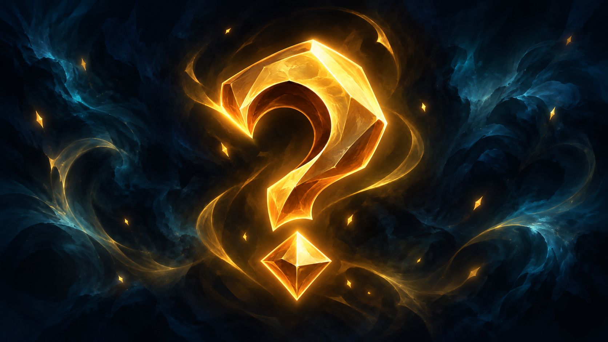

Born of the draconic forge, the Nnor are goat-like humanoids shaped by Charon, the Primordial Dragon of Fire. An elemental spark flows through them. Strong and nimble, they live in the high mountains or in volcanic caverns, carrying an inner fire that stands for freedom and for devotion to their maker alike. Close-knit, fierce and proud, they each bear the same inner flame, a symbol of freedom and devotion.

> "Saman, hear my voice: the Nnor are not mere servants of my flame, but its guardians. You sow the spark of the primordial fire in every heart in Eden, freeing the peoples from the shadow and reminding all that freedom is born of passion. Go, forge your colony, and see that my fire never goes out."
>
> :source[Charon, addressing Saman, his emissary, after he had passed the trial of fire.]

## Fur and hardiness

Across the sheer ridges and frozen crevasses of Eden, the Nnor cut a commanding figure: a broad chest borne on powerful shoulders, and long, muscular legs that end in hooves as sharp as crampons. Their coat is thick and woolly, and its colour depends on the lineage. Some wear fur as black as ink, while others range from spotless white to pearl grey or earthy brown, shades that serve as natural camouflage. They use their massive horns, which follow the line of the brow, to defend themselves, to hold on to rock walls and to assert social dominance. Every muscle stands out beneath the heavy fleece, the sign of uncommon endurance and of millennia spent adapting to violent winds and extreme temperatures. Shaped by the harshness of the mountain climate, their build pairs raw strength with a surprising suppleness, which makes them born climbers and formidable opponents.

## The Yurta above all

For the Nnor, the tribe, which they also call the Yurta, is a sacred bond that ties every member to their people and to Charon. The Samans regularly summon all the workers to ceremonies where the ancestral sagas are sung; there they renew the oaths of loyalty and rekindle the primordial flame. Their title is the name of Saman, Charon's emissary, and they bear it in his honour. Tribal councils, with the Saman presiding, give each member their tasks (hunting, craftwork, gathering medicinal plants or raising stone altars), with a constant eye to the cohesion and survival of the tribe.

The Nnor have a supernatural gift: members of the same tribe seem to understand one another without a word spoken. Thanks to this almost telepathic communication within the tribe, they coordinate group manoeuvres with disconcerting precision, which helps them survive in hostile country, whether on a shared hunt or during a great winter migration.

An ancient schism gave rise to two main subspecies among the Nnor: Charon's Nnor, marked by the draconic hierarchy, and the Alpine Nnor, who live communally. In the tribes loyal to Charon, the caste is made up of workers subject to the Saman, who in turn answers to the Dragonnor, chosen by the Ritual of Fire. In the communal tribes, the members elect a single Saman democratically, without any draconic intervention, and everyone takes an equal part in the tribe's work.

Araskha, the largest Yurta known, is home to thousands of Nnor. Sheltered beneath a vault of basalt, it is laid out around a great eternal hearth, from which countless galleries branch off to house forges, workshops and sacrificial altars. To break the unity of the tribe is to break the chain that binds the Nnor to the very source of their existence.

## The cycle of fire

A Saman can leave their Yurta and set out on a quest. They make for Mount Edros and go on into Charon's Lair, where Charon allows them to undergo the Ritual of Fire. If they fail, they die. If they succeed, the ritual transforms them into a Dragonnor, which comes back out of Mount Edros to find the place where it will establish its own Yurta. Such is the cycle of the Nnor.

The Dragonnor is sometimes counted among the subspecies of the Nnor, but specialists hold the Dragonnor and the Nnor to be two entirely different beings. A Dragonnor has neither the limbs nor the size of a Nnor, and its abilities differ too: it alone begets Charon's Nnor. It fertilises itself and lays the eggs from which they hatch. Charon's Nnor themselves lay no eggs.

## Where the wild meets the city

Faithful as they are to their mountains, the Nnor feel a growing curiosity about the human cities nearby. Those whose Yurta lies beside a great market learn to deal in hides, metals and spices, and gladly barter their handiwork for cloth or musical instruments.

Ever careful not to upset the natural balance, they make sure their caravans harm neither the trails nor the surrounding wildlife. Their fascination with civilisation shows in their art as well, in frescoes inspired by city mosaics and in sculptures that blend goat-like frames with human motifs: proof that, for the Nnor, progress and respect for the wild can go hand in hand.

## Fiery-hearted mountain folk

The Nnor are cheerful by nature. Playful and fond of pranks, they like to break up their labour with jokes the whole group shares, and will go as far as staging proper skits together. Their mood has an edge of fierce pride, though: mock them or threaten their tribe, and their anger can break as suddenly as a mountain storm. For all their loyalty to the Yurta, they remain curious and open.

The Nnor are known for unfailing endurance and steadfast loyalty. People praise the way they face the worst conditions with unshakeable courage while keeping a keen sense of honour and tradition. Their talent for trade often surprises city dwellers, as much for the quality of their dealings as for their uncompromising honesty.

Their deep respect for nature shows in everything they do, even when they venture away from their mountain, and they take scrupulous care never to upset the balance of the places they frequent. Yet beneath this outward good humour smoulders a fierce pride: any slight against their Yurta or threat to their tribe can set off an anger as swift and relentless as a storm on the high peaks.

## Nnor names

A Nnor receives a first name at birth, chosen by the Saman during a rite in which ancestral voices and draconic murmurs mingle to reveal the child's essence (a bond with fire, wind or stone). The name reflects a trait of character, a mark of honour or an elemental affinity, and it never changes for as long as the Nnor lives. Alpine Nnor, who are male or female, bear first names drawn from the forces of the mountain and of the cold, while the Nnor of the draconic line, who have no sex, receive blunter names, charged with the might of the primordial fire. To this personal name is added a family name, the name of the Yurta, inherited from the tribe and handed down from generation to generation as a constant reminder of their shared belonging. No nickname is given unless some notable deed justifies it, for every naming takes its place in the living, sacred history of the Nnor people.
